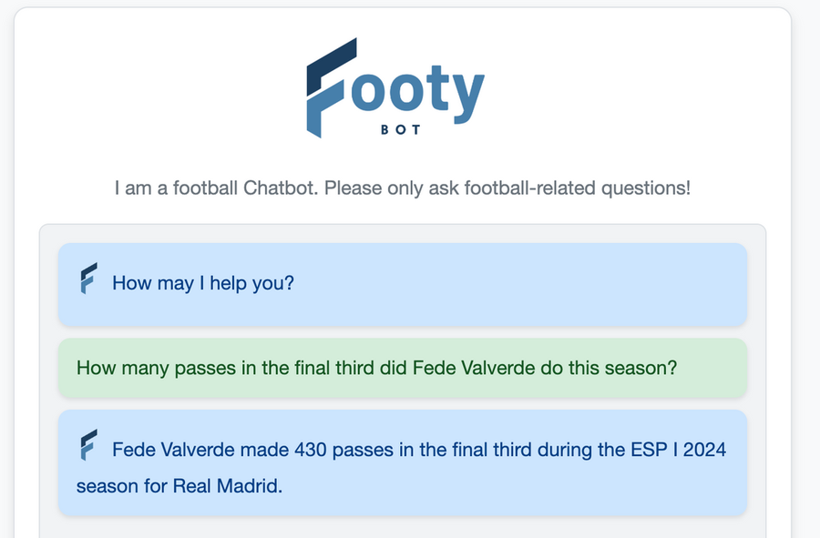
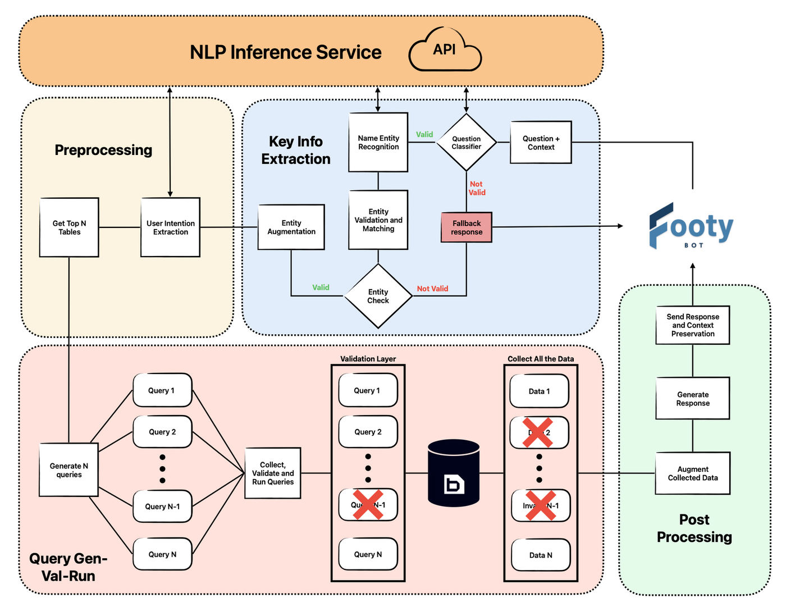
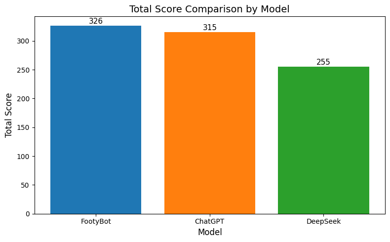
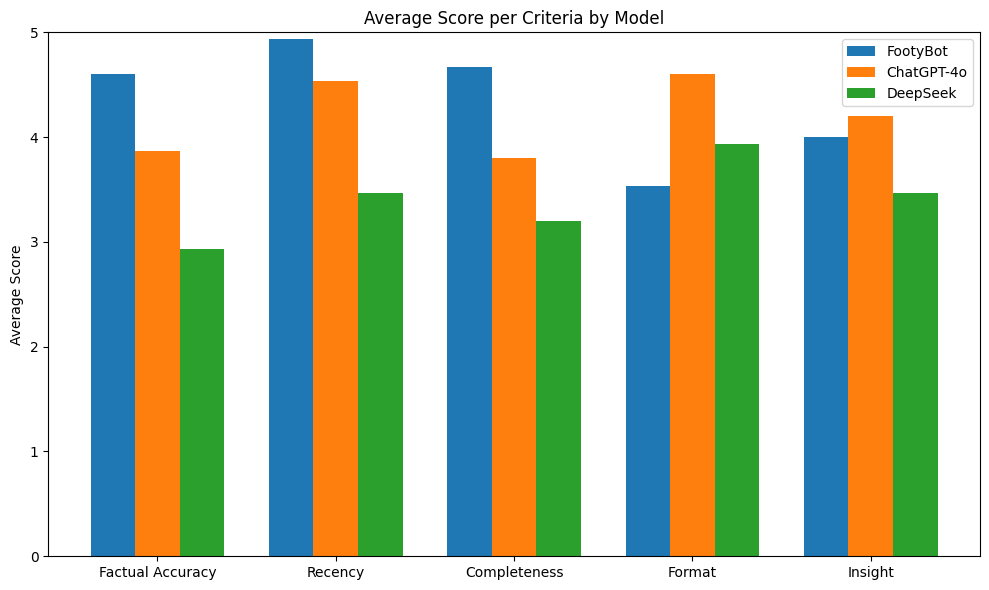

# FootyBot

**A football data chatbot that turns plain-language questions into SQL over a private football database and answers in English or Spanish.**

Coaches, scouts and analysts have more data than ever, but getting a single number out of it usually means knowing the database schema and writing SQL. FootyBot lets them just ask: *"How many passes in the final third did Fede Valverde make this season?"*

<p align="center">
  
</p>

This is the code for my Bachelor's thesis in Business Administration at IE University (April 2025, supervised by Aqib Siddiqui), *How can NLP systems bridge the gap between technical football data and non-technical users?* It was built on [Driblab](https://www.driblab.com)'s football database.

## Key results

| | |
|---|---|
| Overall score vs ChatGPT-4o and DeepSeek (both with web search) | **326 / 375**, vs 315 and 255 |
| Named entity recognition (players, teams, seasons, years) | F1 = 86.6% |
| Football vs non-football question classifier | 99.5% accuracy |
| Intent classifiers (player vs team, match vs season) | 99% and 86% accuracy |
| Languages | English and Spanish |

## How it works

FootyBot is a retrieval-augmented generation (RAG) pipeline with four stages, supported by a separate NLP inference service that keeps the models loaded in memory.



### 1. Key information extraction

- A fine-tuned **multilingual BERT** classifier first checks that the question is about football. Anything else gets a fallback answer before any LLM or database call is made.
- A fine-tuned **XLM-RoBERTa-large** NER model extracts players, teams, seasons and years.
- Each entity is matched against the database with fuzzy matching, boosted by the other entities in the question. "Mbape" alone matches Ethan Mbappé and Kylian Mbappé almost equally, while "Mbape ... Real Madrid" picks Kylian with 71.5% similarity. Below a 70% threshold, FootyBot asks the user which one they mean.
- Matched entities are enriched with their database IDs, leagues and seasons.

### 2. Preprocessing

- Two classifiers detect the **entity of interest** (player or team) and the **aggregation level** (match or season).
- Every database table has a natural-language description embedded with OpenAI's `text-embedding-3-large`. The question is embedded the same way, tables are ranked by cosine similarity, and tables that match the detected intent get a score boost.
- The **top 5 tables** are kept. Testing showed N = 5 is the best trade-off: more tables add cost, latency and noise, fewer risk missing the right one.

### 3. Query generation, validation and execution

- One SQL query per selected table is generated **in parallel** with GPT-3.5-turbo.
- Every query is validated before it reaches the database: `SELECT` only, every column must exist in the target table, and empty or malformed queries are dropped.
- Queries run in parallel. If one fails, the database error is sent back to the LLM for **a single correction attempt**, which avoids correction loops.

### 4. Post-processing

- IDs in the results are replaced with readable names (players, teams, matches).
- A lightweight LLM writes the final answer from the question, the matched entities, the SQL used and the data.
- The entity context is stored, so follow-ups like *"and what about assists?"* work.

## NLP models

| Model | Base | Training data | Result |
|---|---|---|---|
| Named entity recognition | `xlm-roberta-large` | 6,372 sentences from ESPN, MARCA, AS, The Guardian and BBC, labelled with GPT and augmented with lowercase and typo variants | F1 86.6% |
| Entity of interest (player / team) | `bert-base-multilingual-cased` | 2,334 questions generated with GPT-4o from real database records, EN and ES | 99% accuracy |
| Aggregation level (match / season) | `bert-base-multilingual-cased` | Same dataset | 86% accuracy |
| Football question classifier | `bert-base-multilingual-cased` | 4,668 questions: the football set plus Quora Question Pairs, half translated to Spanish | 99.5% accuracy |

The typo and lowercase augmentation matters because users type faster and less carefully than journalists write.

## Evaluation

FootyBot was compared with ChatGPT-4o and DeepSeek, both with web search, on 15 football questions ranging from player stats to team and match details. Each answer was scored from 1 to 5 on five criteria.

<p align="center">
  
  
</p>

FootyBot led on **factual accuracy, recency and completeness**, because it reads the data directly instead of searching the web. For example, asked for Fede Valverde's passes in the final third, FootyBot gave the total, ChatGPT-4o only had successful passes, and DeepSeek pointed to other websites.

ChatGPT-4o led on **format and insight**. This is partly by design: FootyBot returns the numbers without commentary, so analysts draw their own conclusions and the model has less room to add bias or hallucinated narrative.

## Repository structure

```
footybot/
├── chat_bot/
│   ├── server.py                # Flask app: chat endpoint and web UI (port 9876)
│   ├── run_chatbot.py           # Main pipeline, from question to answer
│   ├── data_loader.py           # NLP inference service: NER, classifiers, league matching (port 5005)
│   ├── extract_keyinfo.py       # Stage 1: question check, NER, entity matching
│   ├── entity_validator.py      # Fuzzy entity matching against the database
│   ├── get_user_intention.py    # Stage 2: entity of interest and aggregation level
│   ├── get_top_tables.py        # Stage 2: embedding-based table ranking
│   ├── chat_query.py            # Stage 3: SQL generation with the LLM
│   ├── query_runner.py          # Stage 3: parallel query execution
│   ├── sql_utils/               # SQL validation and error correction
│   ├── post_processing.py       # Stage 4: ID to name mapping and answer generation
│   ├── embedding/               # Table description embeddings
│   ├── write_db_description/    # LLM-written table descriptions
│   ├── vm_materialized_views/   # Schema and descriptions for materialized views
│   ├── preload_db_data/         # Player, team and season lookups
│   ├── open_ai_messages/        # Prompt templates
│   ├── notebooks/               # Latency and SQL analysis
│   ├── webpage/                 # Chat interface
│   ├── db_config.py             # Database settings from environment variables
│   └── config.py                # OpenAI client
├── docs/figures/
├── .env.example
└── requirements.txt
```

## Running the code

FootyBot was built against Driblab's private database, so it **cannot run as is**. The database, the schema files, the table embeddings and the trained model weights are not included. The code is published so the design can be read and reused with another football database.

To adapt it:

1. `pip install -r requirements.txt` and `python -m spacy download en_core_web_sm`.
2. Copy `.env.example` to `.env` and fill in your OpenAI key and PostgreSQL connection.
3. Generate the schema and table descriptions (`write_schema.py`, `write_db_description/`) and embed them (`embedding/`).
4. Train or plug in the NER and classifier models, then start the inference service from the repo root: `python chat_bot/data_loader.py`.
5. Start the chatbot: `python chat_bot/server.py`, then open `http://localhost:9876`.

## Limitations and next steps

- **Languages.** The models were trained on English and Spanish only.
- **Text only.** No video input. Scouts often work from match footage.
- **Fixed schema.** Adding or changing a table means regenerating its description and embedding by hand. A scheduled job that detects schema changes would remove that step.

## Author

**Sebastian Vasquez**, data scientist and engineer. [LinkedIn](https://www.linkedin.com/in/sebastianvasquez2002/)
